<div align="center">
  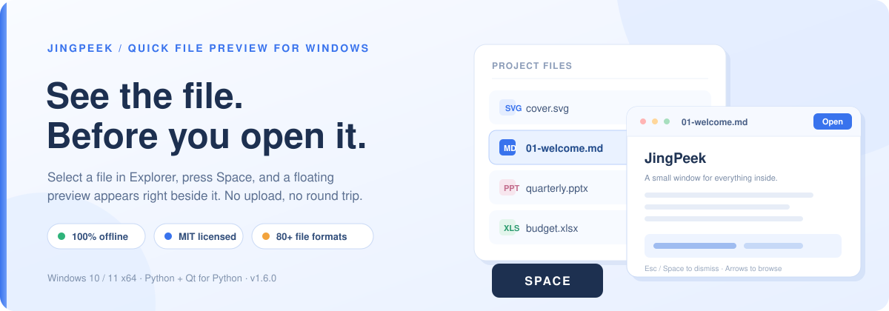

  [](https://github.com/jingpanlong/JingPeek/releases/latest)
  [](LICENSE.txt)
  [](#requirements)
  [](#build-from-source)
  [](https://github.com/jingpanlong/JingPeek/releases)

  **Select a file in Explorer. Press <kbd>Space</kbd>. See its content in a floating window right beside it.**

  [Download v1.6.0](https://github.com/jingpanlong/JingPeek/releases/tag/v1.6.0) · [中文文档](README.zh-CN.md) · [Report an issue](https://github.com/jingpanlong/JingPeek/issues)
</div>

---

**JingPeek (景速览)** is a local, offline quick-preview utility for Windows 10/11 x64, inspired by macOS Quick Look. It runs quietly in the system tray and turns the Space key into a fast, inline look at almost anything in a folder. You never have to open a viewer application, upload a file, or leave the folder you are working in.

> No account. No cloud. No network call at runtime. Your files are parsed on your own machine and are never modified.

## Contents

[Highlights](#highlights) · [Screenshots](#screenshots) · [Download & install](#download--install) · [Getting started](#getting-started) · [Keyboard shortcuts](#keyboard-shortcuts) · [Format support](#format-support) · [Privacy & system integration](#privacy--system-integration) · [Build from source](#build-from-source) · [Project layout](#project-layout) · [Limitations](#limitations) · [License](#license)

## Highlights

- **Preview from Explorer, not from an app window.** Single-click a file on the desktop or in Windows Explorer, press <kbd>Space</kbd>, and an always-on-top preview appears next to it. This is JingPeek's own floating window, not Explorer's built-in preview pane.
- **Genuinely broad format coverage.** Images (including HEIC/AVIF/PSD composites), animated GIF, audio, video, PDF, Word/Excel/PowerPoint with original layout, source code with syntax highlighting, Markdown, CSV, archive listings, folders — and a useful fallback for every readable file.
- **Full static Office rendering.** A bundled, isolated LibreOffice engine converts DOC/XLS/PPT families to static PDF previews that keep pages, images, tables, charts and styling. Word/PPT pages can be flipped; Excel sheet tabs can be switched, including hidden sheets. Text-only extraction is a deliberate manual option, never a silent downgrade.
- **Media that just plays.** If the system backend lacks a codec, a bundled FFmpeg transcodes to H.264/AAC MP4 (PCM WAV for audio) in the same preview window. No codec packs, no external player, no changes to the original file.
- **Everything has a floor.** Any file the current account can read shows properties plus detected text (first 64 KB) or hex content (first 4 KB) — including empty, extensionless and unknown files.
- **Bilingual, instantly.** Switch between 简体中文 and English in Preferences; the whole UI, tray, tooltips and installer update immediately and the choice is persisted. File names and document content stay untouched.
- **Built for the real Windows desktop.** Works with native Explorer, redirected/public desktops and Tencent DeskGo desktop organizer. The Space hook ignores text fields, address bars, rename mode and unrelated windows.
- **Two ways to run.** A native C# single-file launcher that extracts its offline engine once into a version/hash-isolated cache, or a conventional Inno Setup installer. No Python installation is required for either.
- **Resident and light.** Starts into the tray with no main window, keeps a single instance, loads previews in the background, and reuses an Office preview cache across launches.

## Screenshots

The 1.6.0 interface in English:

<table>
  <tr>
    <td width="50%"><a href="docs/screenshots/main-window-en.png">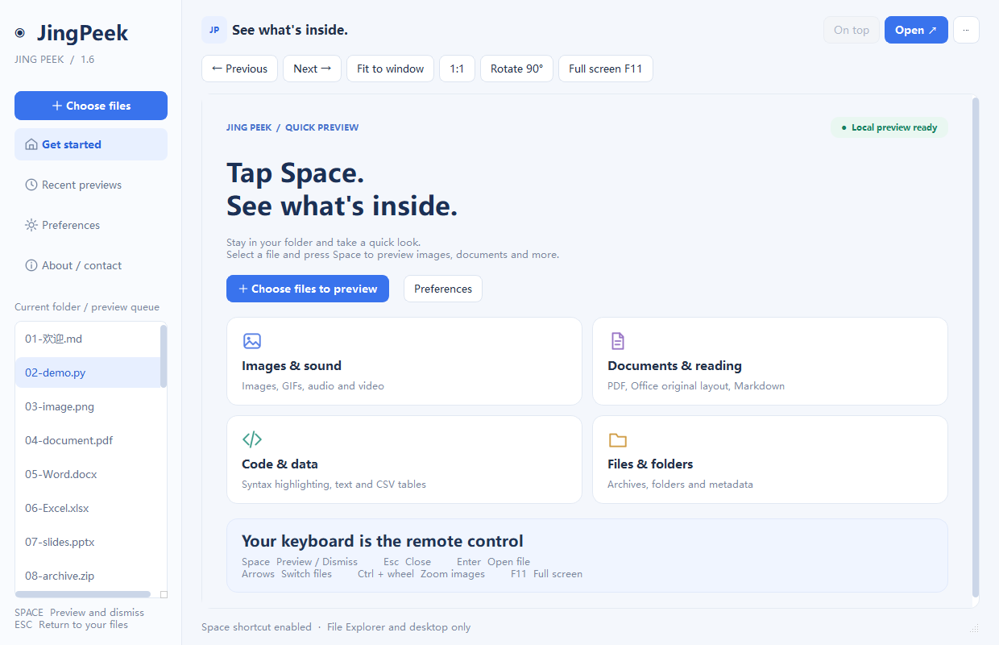</a><br><sub><b>Dashboard</b> — start here, or ignore it entirely.</sub></td>
    <td width="50%"><a href="docs/screenshots/about-en.png">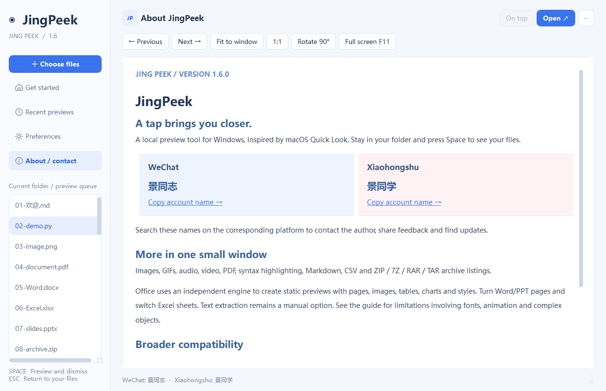</a><br><sub><b>About / contact</b> — version, author and project links.</sub></td>
  </tr>
  <tr>
    <td width="50%"><a href="docs/screenshots/preferences-en.png">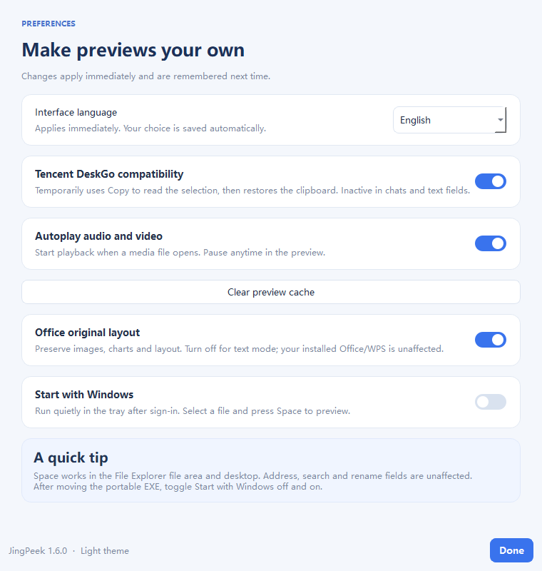</a><br><sub><b>Preferences</b> — language, startup, layout engine and cache.</sub></td>
    <td width="50%"><a href="docs/screenshots/preferences-zh.png"></a><br><sub><b>Same dialog in Simplified Chinese</b> — switch without restarting.</sub></td>
  </tr>
</table>

<details>
<summary><b>More previews — Office, PDF, media, code, archives and tools</b></summary>
<br>

<table>
  <tr>
    <td width="50%"><a href="docs/screenshots/word-layout.png">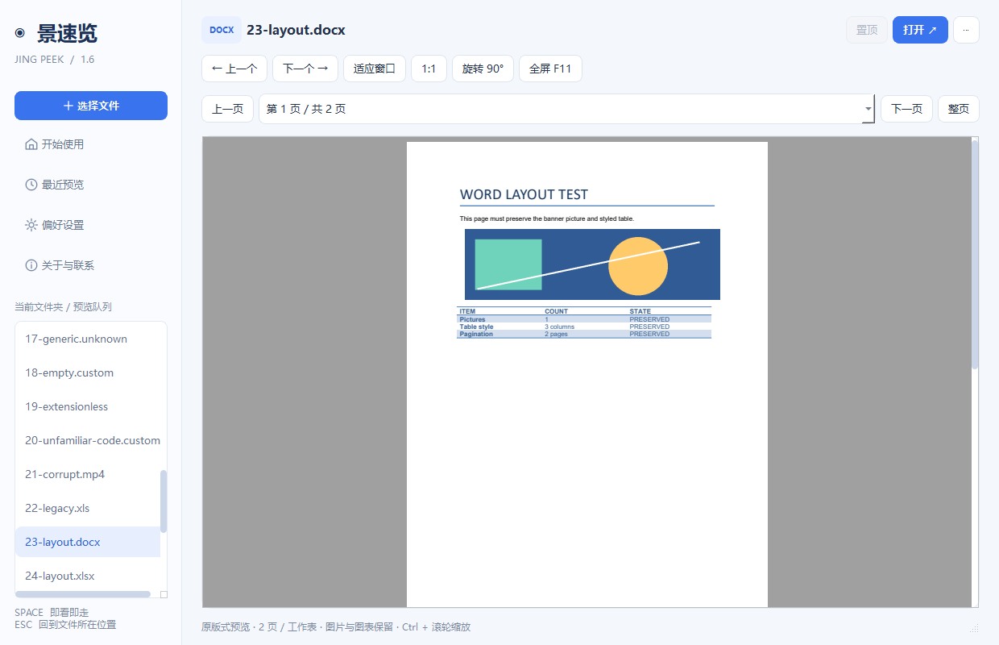</a><br><sub>Word — original static layout</sub></td>
    <td width="50%"><a href="docs/screenshots/excel-charts.png">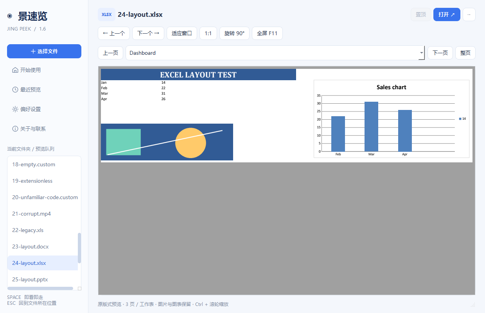</a><br><sub>Excel — merged cells, formatting and charts</sub></td>
  </tr>
  <tr>
    <td width="50%"><a href="docs/screenshots/powerpoint-slide.png">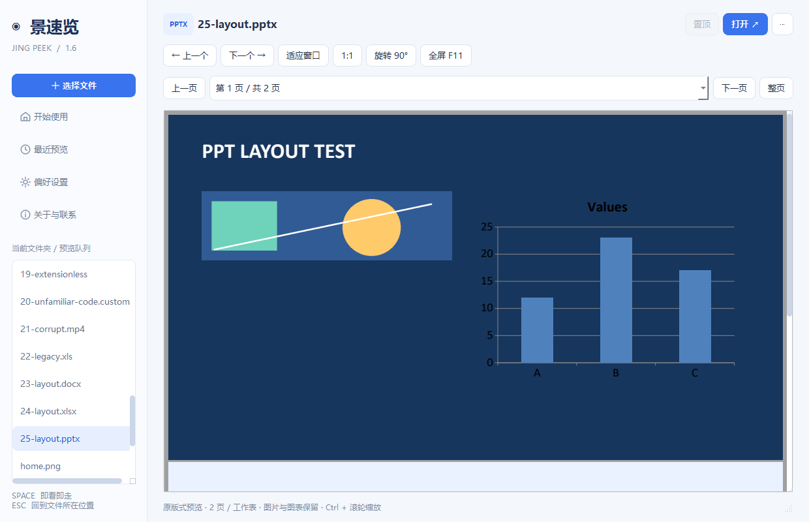</a><br><sub>PowerPoint — slide with images</sub></td>
    <td width="50%"><a href="docs/screenshots/pdf-reading.png">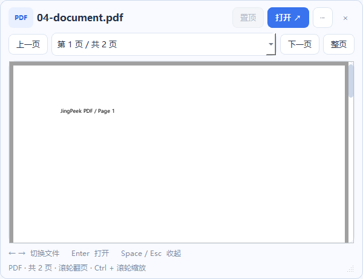</a><br><sub>PDF — multi-page scroll and zoom</sub></td>
  </tr>
  <tr>
    <td width="50%"><a href="docs/screenshots/code-highlighting.png">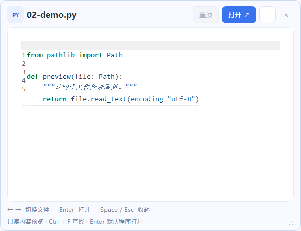</a><br><sub>Source code — Pygments highlighting and line numbers</sub></td>
    <td width="50%"><a href="docs/screenshots/markdown-render.png"></a><br><sub>Markdown — headings, tables, quotes and local images</sub></td>
  </tr>
  <tr>
    <td width="50%"><a href="docs/screenshots/video-playback.png"></a><br><sub>Video — inline playback and built-in compatibility decoding</sub></td>
    <td width="50%"><a href="docs/screenshots/image-preview.png"></a><br><sub>Image — fit, 1:1, rotation and Ctrl+wheel zoom</sub></td>
  </tr>
  <tr>
    <td width="50%"><a href="docs/screenshots/archive-listing.png"></a><br><sub>Archives — directory listing without extracting to disk</sub></td>
    <td width="50%"><a href="docs/screenshots/file-info-tools.png">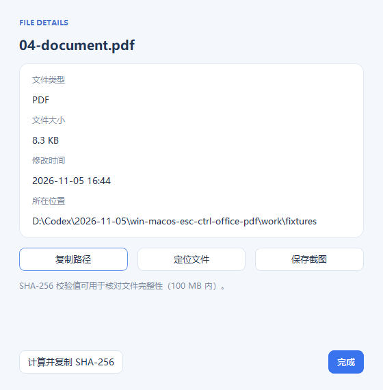</a><br><sub>File info — copy path, locate, screenshot, SHA-256</sub></td>
  </tr>
  <tr>
    <td width="50%"><a href="docs/screenshots/unknown-file-fallback.png">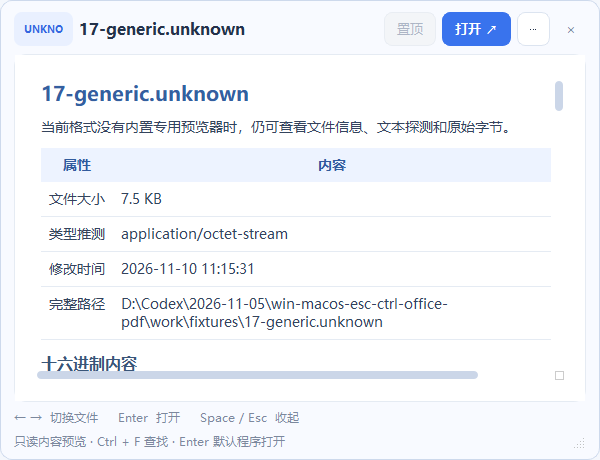</a><br><sub>Unknown files — properties, text sniff and hex view</sub></td>
    <td width="50%"><a href="docs/screenshots/space-workflow.png">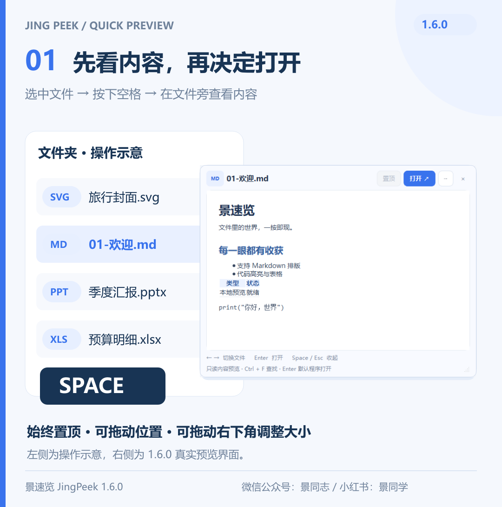</a><br><sub>Workflow — select a file, press Space, preview in place</sub></td>
  </tr>
</table>

</details>

## Download & install

Get both builds from the **[v1.6.0 release page](https://github.com/jingpanlong/JingPeek/releases/tag/v1.6.0)** (or always-fresh **[latest release](https://github.com/jingpanlong/JingPeek/releases/latest)**).

| Build | File | Size | When to choose it |
| --- | --- | --- | --- |
| Portable, single file | [`JingPeek-Portable-1.6.0-x64.exe`](https://github.com/jingpanlong/JingPeek/releases/download/v1.6.0/JingPeek-Portable-1.6.0-x64.exe) | ~693 MB | One EXE, no installation, ideal for a USB drive. Extracts its offline engine on first run. |
| Installer | [`JingPeek-Setup-1.6.0-x64.exe`](https://github.com/jingpanlong/JingPeek/releases/download/v1.6.0/JingPeek-Setup-1.6.0-x64.exe) | ~550 MB | Fixed install location, optional desktop shortcut and Explorer context menu, Chinese/English setup wizard. |

SHA-256 checksums:

```
7de0b14e809f3b53ff659f8fef51d272e3652e27f8a3fa3abadfede5cb163c18  JingPeek-Portable-1.6.0-x64.exe
7037ce077a563b2bba1f021e5374a0b42314e45aef4a33ab43a525374caf47d6  JingPeek-Setup-1.6.0-x64.exe
```

> **The binaries are not code-signed.** Version 1.6.0 was built without a purchased signing certificate, so Windows SmartScreen may warn on first launch. Verify the checksum above, then choose "More info → Run anyway" only if you trust this repository. Signing the release with the publisher's certificate is recommended before redistribution.

### Requirements

- Windows 10 or Windows 11, x64.
- No Python, .NET runtime download or Office installation needed — the rendering engine is shipped offline inside the EXE.
- **Disk space:** the portable build extracts roughly **1.7 GB** of offline engine files on first launch (into `%LOCALAPPDATA%\JingPeek\portable\<version>-<hash>`). First run shows a cancellable progress dialog; later launches reuse the cache. Keep that folder while the app is running; it can be removed after a full exit.
- A code-signed build is *not* provided yet (see note above).

## Getting started

1. Run either EXE **once**. It starts directly into the system tray and does **not** open a main window — that is expected.
2. In Windows Explorer or on the desktop, **single-click a file** (for example `SHA256SUMS.txt`) and press <kbd>Space</kbd>.
3. A floating 600 × 460 preview appears beside the file, preferring the right side and falling back to the left or another on-screen position. A loading hint shows first while parsing happens in the background.
4. Drag the title bar to move it, drag the bottom-right corner to resize. Press <kbd>Esc</kbd> or <kbd>Space</kbd> again to dismiss; <kbd>Enter</kbd> opens the file with its default application; arrow keys walk through the folder.
5. Right-click the tray icon for **Preferences**, **About / contact**, **Help** and **Quit JingPeek**. Double-click it to open the guide. Closing a preview never stops the resident service.

The preview window is always on top. Single-file selections build a queue of files in the same folder sorted by natural name (independent of Explorer's current sort order); multi-selections browse only the selected queue; selecting a folder lists its contents. Text and spreadsheet previews are selectable and copyable.

Command line: `JingPeek.exe --quit` (fully exit), `--background` (silent tray start), `--dashboard` (open the guide). Background start is already the default.

## Keyboard shortcuts

| Key | Action |
| --- | --- |
| <kbd>Space</kbd> | Summon the preview from Explorer/desktop; hide it when the preview has focus |
| <kbd>Esc</kbd> | Hide the preview and return focus to Explorer; tray service keeps running |
| <kbd>Enter</kbd> | Open the current file with its default application |
| <kbd>←</kbd>/<kbd>↑</kbd>, <kbd>→</kbd>/<kbd>↓</kbd> | Previous / next file, wrapping around the queue |
| <kbd>Ctrl</kbd> + mouse wheel | Zoom images and PDF pages |
| <kbd>Ctrl</kbd> + <kbd>O</kbd> | Choose a file manually |
| <kbd>Ctrl</kbd> + <kbd>F</kbd> | Find text in the current preview (PDF has no built-in search) |
| <kbd>F11</kbd> | Toggle full screen |

The More menu on the preview title bar offers fit-to-window, 1:1, static image rotation, full screen, and file information. Media previews include play/pause, seeking and volume. The file-info panel can copy the path, reveal the file in Explorer, save a screenshot of the current static preview, and compute/copy SHA-256 (files up to 100 MB).

## Format support

| Category | Supported | Notable limits |
| --- | --- | --- |
| Images | PNG, JPEG, BMP, GIF, WebP, TIFF, ICO, SVG, AVIF, HEIC/HEIF, PSD composite, DDS, TGA, PCX, PNM, JPEG 2000, ICNS and other Pillow-decodable formats | Animated GIF plays; PSD layers are not restored; over 80 megapixels falls back to basic view |
| Audio / video | MP4, MKV, AVI, MOV, WebM, WMV, FLV, MPEG, TS, M2TS, 3GP, MXF, RM containers; MP3, WAV, FLAC, AAC, M4A, OGG, Opus, WMA, APE, AMR, AC3, DTS audio | System backend first, bundled FFmpeg on failure. Compatibility mode caps video at 1280 px / stereo, 180 s and 1 GB per job; up to 3 cached conversions per session |
| PDF | Multi-page scroll, fit-to-width, 1:1, Ctrl+wheel zoom | No password prompt, editing, annotations, signatures or OCR |
| Word / rich text | DOC, DOCX, DOCM, DOTX, DOTM, RTF, ODT | Full static pages with images and tables; page navigation and zoom |
| Excel / spreadsheets | XLS, XLSX, XLSM, XLSB, XLT, XLTX, XLTM, ODS | Merged cells, formatting, images and charts; each sheet rendered as one page; hidden sheets are labelled and shown |
| PowerPoint | PPT, PPTX, PPTM, PPS, PPSX, PPSM, POTX, POTM, ODP | Static slides with images and charts, including hidden slides; no animations, transitions or embedded media playback |
| Source code | Python, JS/TS, C/C++, C#, Java, Rust, Go, SQL, HTML/CSS, Shell, PowerShell, JSON/YAML and common text formats | Pygments highlighting with line numbers; HTML is shown as source |
| Markdown | Headings, lists, tables, links, quotes, fenced code, local images in the same folder and subfolders | Rendered with Qt rich text, not a browser engine; raw HTML/scripts are not executed and remote images are not fetched |
| Tables | CSV / TSV | First 500 rows × 40 columns |
| Archives | ZIP, 7Z, RAR, TAR, TAR.GZ, TGZ listings; single GZ/BZ2/XZ streams show the first 64 KB | Up to 2,000 entries; no extraction to disk, no nested preview, no password prompts |
| Folders / anything else | Folder listing (first 2,000 entries); every readable file gets properties plus text/hex fallback | Common PDF, image, ZIP and media types are detected by file signature, so no extension is required |

Office previews are **static renderings, not editable documents**. Missing fonts, special equations, SmartArt, proprietary embedded objects or a different layout engine can cause differences from Microsoft Office; pixel-perfect parity is not guaranteed. Macros are never executed and external links are not updated. Input is capped at 200 MB, generated PDF at 512 MB, each conversion at 120 seconds and 2 GB of process-group memory. A failed conversion reports the error and offers a retry or an explicit text-extraction option.

## Privacy & system integration

- **Local by design.** Files are parsed on the machine; nothing is uploaded and the app makes no proactive network connections. Clicking a web link asks for confirmation, then opens the system browser.
- **Read-only.** Original files are never modified. Archive contents and document macros are never executed. Opening a file with its default app only happens when you press <kbd>Enter</kbd>.
- **Where state lives.** Settings and recent paths: `HKCU\Software\JingTongXue\JingPeek`. Log: `%LOCALAPPDATA%\JingPeek\app.log`. Reusable layout cache: `%LOCALAPPDATA%\JingPeek\cache\office-v2` (clearable in Preferences). Temporary Office PDFs live in the system temp directory and are cleaned up on a normal exit.
- **Autostart** is registered at `HKCU\Software\Microsoft\Windows\CurrentVersion\Run\JingPeek` and can be turned off in Preferences. After moving a portable EXE, toggle autostart off and on again so the path is refreshed.
- **Scope of the Space hook.** Active only in normal Windows Explorer file areas and on the desktop; it does not steal keystrokes from input fields. Third-party file managers, elevated Explorer windows, virtual folders and desktop virtual icons may not expose a real path — drag a real file in or use Ctrl+O instead.
- **DeskGo compatibility.** Tencent DeskGo draws its own desktop without a standard selection API. The compatibility mode is limited to the verified `DesktopMgr64.exe` desktop window: it briefly uses copy to read the file path and restores the clipboard afterwards, refusing to overwrite the clipboard if another copy happened in the meantime. It never touches chat windows or rename/search inputs, and can be disabled in Preferences.
- **Portable engine cache.** The full offline Office engine is bundled inside the EXE; the source archive does **not** duplicate the ~1.5 GB of third-party binaries. The single-file build extracts it once per version/hash; the installed build keeps it in place.
- **Unsigned binaries.** See the note in [Download & install](#download--install).

## Build from source

Requires Windows 10/11 x64, Python 3.12, the .NET Framework 4.8 C# compiler shipped with Windows, and Inno Setup 6 (only for the installer build).

```powershell
python -m venv .venv
.\.venv\Scripts\python.exe -m pip install -r requirements.txt
.\.venv\Scripts\python.exe -c "from comtypes.client import GetModule; GetModule('UIAutomationCore.dll')"
.\prepare_office_engine.ps1
.\.venv\Scripts\python.exe main.py
.\.venv\Scripts\python.exe -m unittest discover -s tests -v
.\.venv\Scripts\python.exe tests\integration.py
.\build.ps1 -Python .\.venv\Scripts\python.exe -ISCC 'C:\Program Files (x86)\Inno Setup 6\ISCC.exe'
```

`prepare_office_engine.ps1` downloads a pinned LibreOffice 26.8.2 build from the Document Foundation, verifies its SHA-256 and signature, and extracts it into `office_runtime/`. It does not install LibreOffice or change file associations. The **first build needs internet access**; the resulting EXEs do not. Third-party license texts and NOTICE files are preserved alongside the binaries. `build.ps1` produces the directory build in `stage/JingPeek`, the single-file portable EXE and the installer EXE. Dependency versions are pinned in `requirements.txt`.

## Project layout

```
main.py                      Application / packaging entry point
jingpeek/
  app.py                     Main window, preview orchestration, About page
  native.py                  Windows integration and selected-file positioning
  positioning.py             Floating-window geometry and mixed-DPI conversion
  background.py              Non-blocking selection and directory reads
  formats.py                 Format parsing and fallback views
  office_render.py           Isolated LibreOffice render scheduling
  media_compat.py            FFmpeg compatibility transcoding
  deskgo.py                  Tencent DeskGo desktop compatibility
  i18n.py, localized_widgets.py, ui.py   Bilingual UI and theming
assets/
  en_US.json                 English message catalog (Simplified Chinese is the source)
  office_render_helper.py    UNO static PDF export helper
portable_launcher.cs         Native C# single-file launcher (first-run extraction)
build_portable.py            Single-file packaging
installer.iss                Inno Setup script (+ ChineseSimplified.isl)
release.spec                 PyInstaller spec
prepare_office_engine.ps1    Pinned offline engine fetch + verification
tests/                       Parser, UI and integration tests
licenses/                    Third-party license texts
docs/screenshots/            Screenshots used in this document
```

## Limitations

JingPeek is a *preview* tool, not a replacement for the authoring application. DRM-protected, encrypted or damaged media, password-protected documents, proprietary CAD/design files, PSD layers, PDF forms and OCR are out of scope; such files usually fall back to properties/text/hex. Office rendering is static and may differ from Microsoft Office. The compatibility decoder is a capped convenience path (1280 px video, stereo audio, 180 s, 1 GB), not a lossless export. Large text reads are capped at 2 MB with a 25-second parser timeout. An unreadable file — due to permissions — cannot be previewed.

References: [Qt PDF](https://doc.qt.io/qtforpython-6/PySide6/QtPdf/index.html), [Qt Multimedia](https://doc.qt.io/qtforpython-6/PySide6/QtMultimedia/QMediaPlayer.html), [PyInstaller](https://pyinstaller.org/en/stable/usage.html).

## Feedback

Bug reports and feature requests are welcome in [GitHub Issues](https://github.com/jingpanlong/JingPeek/issues). The author also publishes Chinese walkthroughs on WeChat (**景同志**) and Xiaohongshu (**景同学**).

## License

Original JingPeek code is released under the **MIT License** — see [LICENSE.txt](LICENSE.txt). Bundled third-party components keep their own licenses (notably Qt/PySide6 under LGPLv3 and GPL-licensed tooling); complete notices are in [THIRD_PARTY_NOTICES.txt](THIRD_PARTY_NOTICES.txt) and [`licenses/`](licenses/).

Built with Python, Qt for Python (PySide6), PyInstaller, Pygments, Python-Markdown, Pillow, imageio-ffmpeg, LibreOffice and Inno Setup. Thanks to all of those projects.
